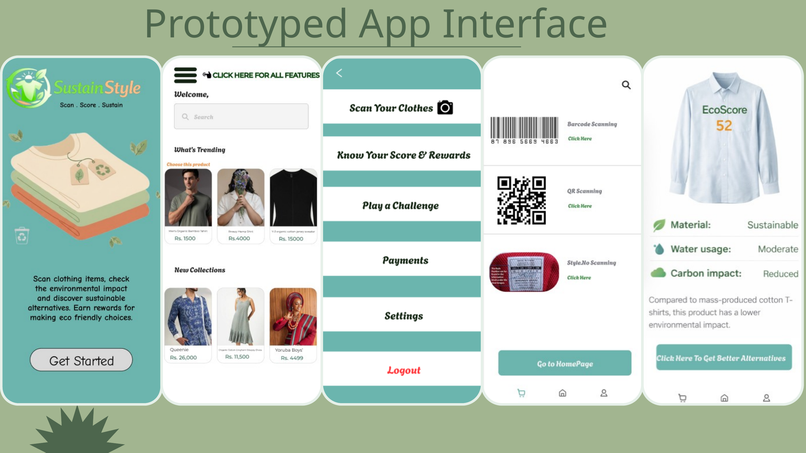
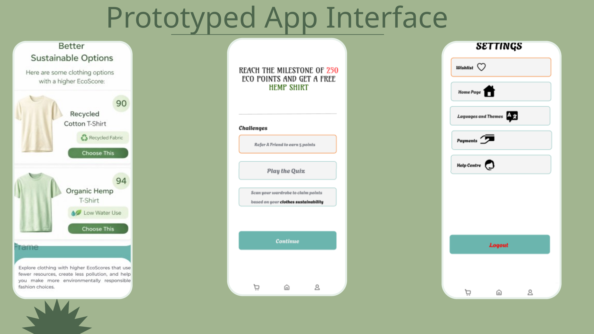

# SustainStyle 🌿

**A sustainable fashion app prototype that helps people make more informed clothing choices.**

SustainStyle is a mobile app concept designed to encourage more responsible fashion consumption. It brings product scanning, sustainability scoring, greener alternatives, and reward-based engagement into one experience.

> **Project status:** UI/UX prototype designed in Figma. The scanning flow and app interactions shown in the presentation are simulated prototype experiences; this repository does not contain a production mobile application or a live sustainability-scoring backend.

## The problem

Fast fashion contributes to carbon emissions, water pollution, microfiber release, and textile waste. At the same time, low prices, rapidly changing trends, and social-media influence can encourage frequent purchases and short garment lifespans. SustainStyle explores how clearer environmental information and positive incentives could help consumers make more sustainable decisions.

## The proposed solution

SustainStyle lets users explore a clothing product's environmental impact and discover more sustainable options. The concept includes:

- **Product scanning:** barcode, QR-code, and style-number scanning options.
- **EcoScore:** a sustainability score displayed after a product is scanned.
- **Greener alternatives:** recommendations for products with higher EcoScores when an item scores poorly.
- **GreenPoints:** points earned through sustainable actions.
- **Milestones and rewards:** progress indicators at 50, 250, and 500 points. One example milestone is unlocking a hemp shirt valued at ₹700 after reaching 250 points.
- **Weekly eco-challenges:** activities intended to encourage continued engagement.
- **Product range:** the concept aims to support choices across basic and premium price/quality levels.

## Prototype preview

The following screens are taken from the project presentation and show the proposed app flow and interface.

### Interface overview



### Alternatives, rewards, and settings



## Design and prototype

The app interface was created in **Figma**. The prototype includes a clean UI, clickable navigation, a simulated scanning experience, and an interactive GreenPoints dashboard.

- [Open the Figma design](https://www.figma.com/design/UaDRXCFUHRDYz2WPkMcoRx/CLOTH-SHOPPING-APP--Community-?node-id=0-1&p=f&t=RP8dxm4tBiMIf1De-0)
- [Open the interactive Figma prototype](https://www.figma.com/proto/UaDRXCFUHRDYz2WPkMcoRx/CLOTH-SHOPPING-APP--Community-?node-id=133-7&p=f&t=RP8dxm4tBiMIf1De-0&scaling=min-zoom&content-scaling=fixed&page-id=0%3A1&starting-point-node-id=133%3A7&show-proto-sidebar=1)

## Repository contents

```text
SustainStyle-GitHub-Repo/
├── assets/
│   └── screenshots/
│       ├── prototype-interface-1.png
│       └── prototype-interface-2.png
├── docs/
│   └── project-overview.md
├── SustainStyle-Presentation.pptx
├── SustainStyle-Presentation.pdf
├── .gitignore
└── README.md
```

## Project documentation

See [`docs/project-overview.md`](docs/project-overview.md) for a concise project brief, feature breakdown, and prototype scope.

## Getting started

There is no application source code to install or run in this repository at this stage. To explore the concept, open the [interactive Figma prototype](https://www.figma.com/proto/UaDRXCFUHRDYz2WPkMcoRx/CLOTH-SHOPPING-APP--Community-?node-id=133-7&p=f&t=RP8dxm4tBiMIf1De-0&scaling=min-zoom&content-scaling=fixed&page-id=0%3A1&starting-point-node-id=133%3A7&show-proto-sidebar=1), or review the presentation files included above.

## Future development possibilities

Potential next steps, beyond the current prototype, could include connecting verified product and supply-chain data, implementing a transparent EcoScore methodology, integrating working barcode/QR scanning, building personalized recommendation logic, and developing a secure GreenPoints account and rewards system. These are possible future directions, not features claimed as already implemented.

## Author

**Dibyajyoti Swain**

---

*This repository documents the SustainStyle concept and its Figma prototype.*
